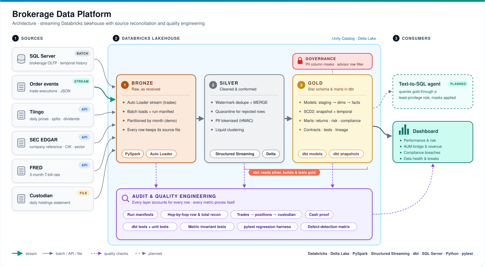

# Brokerage Data Platform

A brokerage and wealth-management data platform, built and **tested** the way a regulated firm would build it.

- **Data:** real market data (daily prices, SEC EDGAR company data) plus a generated brokerage (clients, accounts, advisors, trades, cash) in a SQL Server source system.
- **Pipeline:** trades **stream** into a Databricks lakehouse (bronze → silver → gold) and are modelled into a **dbt star schema**.
- **Proof:** every layer is **reconciled against its source**, and the test suite is measured against deliberately seeded defects.

> 🚧 **Work in progress.** Built in public, one release at a time. See the [Roadmap](#roadmap).

## Architecture

## What this project demonstrates

| Area | How |
|---|---|
| Ingestion | batch extracts from SQL Server and APIs; **Auto Loader** streaming for trades |
| Lakehouse | medallion layers on Delta; streaming dedupe with watermarks + `MERGE`; liquid clustering vs partitioning, with measurements |
| Modelling | dbt star schema: transaction and snapshot facts, **SCD1**, **SCD2** two ways (source temporal history and dbt snapshot) |
| Metrics | time-weighted and money-weighted returns vs the S&P 500; risk (volatility, drawdown, Sharpe, beta); AUM bridge; advisor revenue; suitability compliance — each proved by an invariant test. Later: FIFO tax lots and Brinson attribution |
| Governance | column masks on PII and a row filter so each advisor sees only their own clients |
| Reconciliation | row and control totals at every hop; trades → positions; positions → custodian; cash proof |
| Quality engineering | profiling, dbt tests, pytest regression harness, source-to-target mapping, traceability matrix, defect-detection rate |

## Roadmap

- [ ] **v0.0 — Repo live:** plan, architecture, environment checks
- [ ] **v0.1 — Thin slice:** SQL Server → bronze → silver → dbt → first AUM mart, first reconciliation
- [ ] **v0.2 — Real data + history:** prices, SEC data, SCD1 and two SCD2 patterns
- [ ] **v0.3 — Streaming + governance:** streaming dedupe, full facts and marts, clustering measured, masking and row filter
- [ ] **v1.0 — Quality engineering:** full reconciliation, test suite, defect-detection matrix, QE documents

## Tech stack

Databricks (Free Edition) · Delta Lake · PySpark · Structured Streaming · dbt · SQL Server · Python · pytest · Unity Catalog

## A note on the data

Brokerage clients and trades are **synthetic**, because real brokerage data contains personal information that can never be public. Synthetic data also gives a known ground truth, so the test suite's detection rate can be measured exactly. Securities and prices are real. Raw price data is not committed to this repo, in line with the provider's terms.
